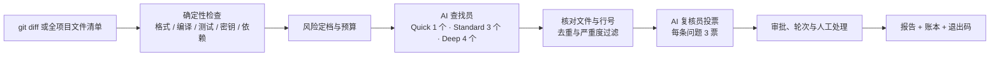

# review-tool

可审计、低成本的 AI 代码审查流水线。固定 DAG 编排、证据核对、多票复核、哈希链账本。

> 早期个人项目（v0.1.0）。适合本地和小团队试验，不建议未经评估直接作为生产门禁。

[](https://github.com/zhuoling-Liu66/review-tool/actions/workflows/ci.yml)
[](LICENSE)


## 为什么做这个

大多数 AI 审查工具的问题是：结论不可追溯、成本不可控、误报无法归因。这个项目把审查拆成一条固定的流水线：先跑确定性检查，再让 AI 找问题，接着核对证据、独立投票，最后用审批、轮次和预算决定放行还是拦截。

它不追求“让 Agent 自由讨论”，而是追求三件事：

- **可审计**：普通审查记录 diff、配置、模型、prompt/context 的哈希；全量扫描记录 HEAD、批次和花费；两者都写入追加式账本。
- **可控制**：单次预算、月度预算、硬停、缓存和轮次上限。
- **可落地**：能本地跑、能进 CI、能生成 GitHub 评论和 SARIF。

## 工作流



更细的中文流程图见 [docs/流程图.md](docs/流程图.md)。

## 它会做什么

- **两种范围**：`review run` 只审一次改动；`review full` 审整个项目。
- **三种力度**：Quick / Standard / Deep，由人或 CI 通过 `--mode` 选择，AI 不会自己决定力度。
- **多视角审查**：Standard 默认 3 个 Finder，Deep 默认 4 个；每条 finding 由 3 个 Verifier 独立投票。
- **证据核对**：检查 AI 说的文件是否存在、行号是否有效、是否落在变更范围。
- **降噪**：按 fingerprint 去重，按严重度过滤，缓存重复请求。
- **风险与审批**：low / medium / high 定档；高风险需要外部审批或显式单人覆盖；审批绑定 diff 和 head。
- **收敛控制**：同一个 PR 最多自动审 3 轮，重置必须写理由。
- **成本控制**：单次 token 预算、月度美元预算、80% 告警、hard stop、AI 结果缓存。
- **可审计产物**：manifest、findings、Markdown/SARIF 报告、JSONL 哈希链账本。
- **集成**：GitHub summary / inline 评论、SARIF、Git hooks、CI 模板、golden-set 评测。
- **全量扫描**：模块分批、成本预估、`--dry-run`、断点续扫。

## 它不会做什么

- 不自动修改代码、不自动合并、不自动部署。
- 不执行 AI 生成的命令或测试。
- 不替代 gitleaks / 依赖扫描 / 单元测试。
- 不把“审查不完整”显示成绿色通过。
- 不在单人仓库伪装强制的职责分离。

## 快速开始

要求：Node.js 22+、git，以及一个可用的模型 API key。

```bash
git clone https://github.com/zhuoling-Liu66/review-tool.git
cd review-tool
npm ci
npm run build
```

在**被审查的项目**里创建配置：

```bash
mkdir -p /path/to/project/.review
cp review.config.example.yml /path/to/project/.review/config.yml
```

设置模型 key（不要把 key 写进配置文件或提交到仓库）：

```bash
export OPENAI_API_KEY=...
# 或 ANTHROPIC_API_KEY=...
# 或使用 openai-compatible provider（例如 DeepSeek）并设置对应的环境变量
```

运行：

```bash
# 审一次改动
./review.sh run --repo /path/to/project --base main

# 只跑确定性检查
./review.sh checks --repo /path/to/project --base main

# 全量扫描：先看计划和成本
./review.sh full --repo /path/to/project --dry-run

# 确认后执行
./review.sh full --repo /path/to/project --yes --budget 2m --max-usd 10
```

Windows 使用 `review.cmd`：

```bat
review.cmd run --repo C:\path\to\project --base main
review.cmd full --repo C:\path\to\project --dry-run
```

包装脚本会在 `node_modules` 或 `dist/cli.js` 缺失时自动执行 `npm install` / `npm run build`。

## 审查范围与力度

| 力度 | 只审改动（`run`） | 全项目（`full`） |
|---|---|---|
| Quick | 1 个 Finder；仅 blocker/security 做 1 票轻验证 | 每批 1 个 Finder，不投票 |
| Standard | 3 个 Finder；每条 finding 3 票 | 每批 1 个 Finder，换用标准模型 |
| Deep | 4 个 Finder；强模型；每条 finding 3 票 | 每批 1 个 Finder，换用更强模型 |

`full` 是**范围**，Quick/Standard/Deep 是**力度**。全量扫描目前不会因为选了 Standard/Deep 就自动变成多 Finder 投票。

## 常用命令

| 命令 | 作用 |
|---|---|
| `review run --base main` | 审查一次改动 |
| `review checks --base main` | 只跑确定性检查 |
| `review full --dry-run` | 估算全量扫描成本，不调用模型 |
| `review full --yes` | 正式开始全量扫描 |
| `review full --resume` | 从断点继续未完成的全量扫描 |
| `review report --run <id> --format sarif` | 重新导出报告 |
| `review approve --run <id> --external --as <login>` | 记录高风险审批 |
| `review reset-rounds --pr <n> --reason "..."` | 重置 PR 审查轮次 |
| `review ledger verify` | 校验账本哈希链 |
| `review config validate` | 校验配置 |
| `review budget` | 查看当月 AI 花费 |
| `review hooks install` | 安装原生 git hooks |
| `review eval --update-baseline` | 运行 golden set 并更新基线 |
| `review metrics --since 30d` | 查看质量、成本和轮次指标 |
| `review scan --since 30d` | 影子扫描近期变更，只产出 backlog |
| `review gc --days 90` | 清理过期 artifact |

更多示例：

```bash
./review.sh run --repo /path/to/repo --base main --mode standard
./review.sh run --repo /path/to/repo --base main --mode deep
./review.sh run --repo /path/to/repo --base main --pr 123 --require-approval
./review.sh run --repo /path/to/repo --base main --shadow
./review.sh run --repo /path/to/repo --base main --json

./review.sh outcome --repo /path/to/repo --run <run_id> --finding f_001 --status fixed
./review.sh outcomes --repo /path/to/repo --since 30d
./review.sh metrics --repo /path/to/repo --since 30d
```

## 配置

配置位于目标仓库的 `.review/config.yml`，示例见 [review.config.example.yml](review.config.example.yml)。

主要配置段：

- `providers` / `models`：OpenAI、OpenAI-compatible（如 DeepSeek）、Anthropic 或 mock。
- `pricing`：按模型名配置每百万 token 的输入/输出价格，用于成本统计。
- `budget`：各模式 token 预算、单次硬上限、月度美元预算、80% 告警、hard stop。
- `checks`：format / lint / type / test 命令；日志归档为证据。
- `tiers`：敏感路径、依赖路径、低风险路径、大 diff 阈值。
- `review`：Finder 视角、上下文上限、跳过路径、最小报告严重度、多 Agent 开关。
- `security`：gitleaks / Semgrep / osv，可 skip 或 required 阻断。
- `approval`：各风险档的审批方式、冷静期、是否允许单人覆盖。
- `rounds`：同一 PR 的最大自动审查轮次。
- `cache`：AI 结果缓存开关。

模型 key 只通过环境变量读取，例如 `OPENAI_API_KEY`、`ANTHROPIC_API_KEY`，或你在 provider 里自定义的 `*_API_KEY`。不要把真实 key 写入配置文件。

## 预算与费用

普通审查：

- 预算取 `budget.per_run_tokens[mode]`，可被 `--budget` 覆盖，并受 `budget.hard_max_tokens` 截断。
- 每次模型调用先预留“输入估算 + 最大输出”，调用后按实际用量结算。
- 达到 `warn_at`（默认 80%）写警告；预算耗尽则审查不完整（退出码 4）。
- 月度用量达到 80% 写警告；开启 `monthly_hard_stop` 时达到上限阻止 AI。

全量扫描：

- 先估算未完成批次的 token 和美元；`--max-usd` 超预估直接拒绝，`--budget` 是整次扫描的 token 上限。
- 每批先预留“输入 + 最大输出”，不足则停止；每批结束立即写 `state.json`。
- `--max-usd` 只做开始前的估算拦截，运行中的硬约束是 token 预算。

已知限制（v0.1.0）：

- `full` 的 `--budget` 是整次扫描总额，目前不套用 `hard_max_tokens`。
- `review budget` 的月度统计目前只累加普通审查的 `agent.invoked` 事件，**不包含 `full` 批次花费**；因此全量扫描暂不受月度美元硬停约束。实际花费仍记录在 `state.json`、报告和账本里。
- 价格按配置中的单价计算；示例配置使用高峰价格，实际账单可能更低。

## 输出与审计

每次运行写入目标仓库：

```text
<repo>/.review/
  ledger.jsonl
  artifacts/<run_id>/
    manifest.json
    findings.json
    report.md
    checks/<name>.log
  full/<scan_id>/
    state.json
    findings.json
    report.md
```

- `ledger.jsonl` 是事实源，事件包含 `prev_hash` / `hash`，可用 `review ledger verify` 检查篡改。
- `manifest.json` 记录 diff 哈希、配置哈希、模型、prompt/context 哈希、预算、检查结果、审批、轮次和退出码。
- `report.md` 是人类可读报告；`findings.json` 给其他工具消费；`report --format sarif` 可导出 SARIF。
- `.review/` 属于运行状态，不应提交到 git；本仓库的 `.gitignore` 已忽略。

## 全量扫描说明

`review full` 读取 git HEAD 中的跟踪文件，按顶级模块分批，每批默认最多 8 个文件或 55k 字符。它会跳过文档、图片、锁文件、`.review` 和超过 200KB 的单文件。

- 未提交的改动不在审查范围；只看 HEAD。
- 每批调用 1 次 Finder，不做 Verifier 投票，结果是 **advisory**，适合做全量盘点。
- `--dry-run` 只估算，不调用模型；`--yes` 用于非交互环境。
- 中途停止后可用 `--resume --scan-id <id>` 继续；如果 HEAD 已变化且扫描未完成，会拒绝续扫。
- 每批进度、token 和花费写入 `state.json`，全部完成或中断都会生成报告。
- 全量扫描不替代 `review checks` 和 `security.*`。

## 评测与运营

- `review eval` 回放 golden set，计算 recall、clean FP、成本和状态；`--update-baseline` 记录基线并做回归对比。
- `review outcome` 记录 finding 的处理结果：`fixed | dismissed | accepted_risk | ignored`；`dismissed` 需要 `--kind error|intentional|minor`。
- `review outcomes` 汇总 finding 生命周期；`review metrics` 输出成本、质量、override、轮次和解决率。
- `review scan --since 30d` 以 shadow 方式扫描近期变更，只产出 backlog，不阻断、不刷评论。
- `--shadow` 会正常运行并记录，但把最终退出码强制为 0；适合先观察效果。

## 安全边界

- 审查 Agent 没有工具、网络和文件系统访问权限。
- 工具不会执行 AI 生成的命令，不会自动修改代码、合并或部署。
- API key 只从环境变量读取；`.review/` 和 `.env*` 默认被忽略。
- 工具会检测 bidi / 零宽字符等提示注入疑点，并写入账本。
- 高风险变更默认需要人工审批；审批记录绑定 diff 哈希和 head 哈希，代码变化后自动失效。

## 已知限制

- 仍是 v0.1.0 个人项目，接口和配置可能变化。
- SQLite 读模型、可视化 dashboard、大规模 golden set、外层 fix-request 自动回环尚未完成。
- `full` 是单 Finder 的建议性扫描，不是最终门禁。
- 月度预算与 `full` 的衔接、`full --budget` 与单次硬上限的统一，仍待完善。
- GitHub 发布与 Actions 模板需要在实际仓库中验证。

## 文档

- [设计文档](docs/设计文档.md)
- [功能规格](docs/功能.md)
- [多 Agent 协同技术可行性](docs/技术可行性-多Agent协同.md)
- [ADR-0001：编排框架选型](docs/ADR-0001-编排框架选型.md)
- [ADR-0002：开发 Agent 外层闭环](docs/ADR-0002-开发Agent外层闭环.md)
- [中文流程图](docs/流程图.md)

## 开发与测试

```bash
npm ci
npm run typecheck
npm test
npm run build
```

测试使用临时 git 仓库和 mock provider，不调用真实模型。CI 见 [.github/workflows/ci.yml](.github/workflows/ci.yml)。

贡献前请先看 [CONTRIBUTING.md](CONTRIBUTING.md)。安全问题请按 [SECURITY.md](SECURITY.md) 私下报告，不要公开贴出密钥或漏洞细节。

## License

[MIT](LICENSE)
