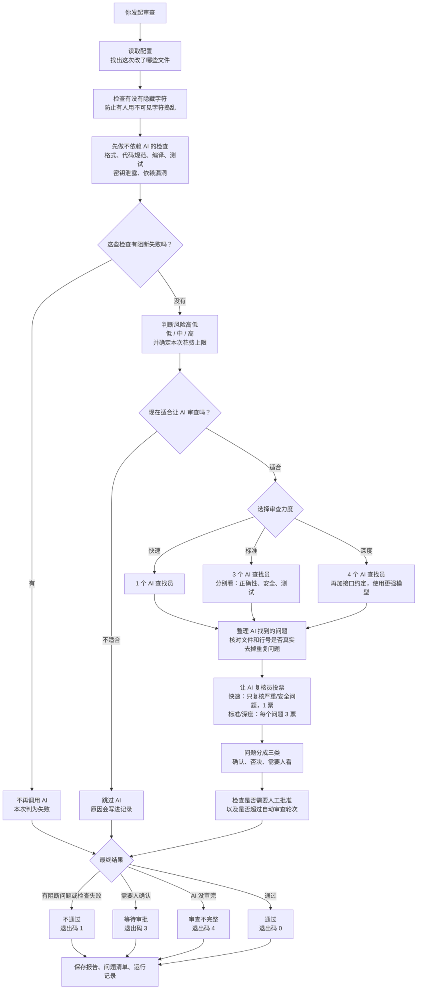
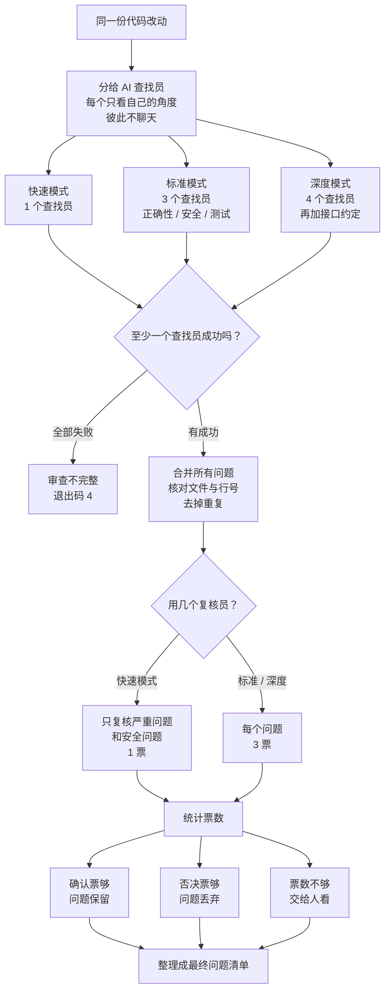
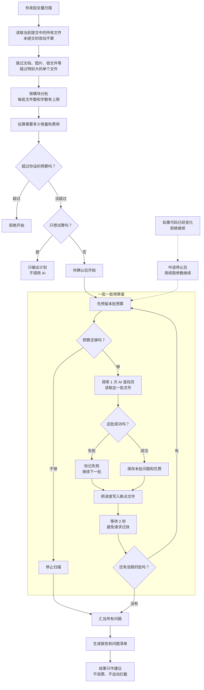
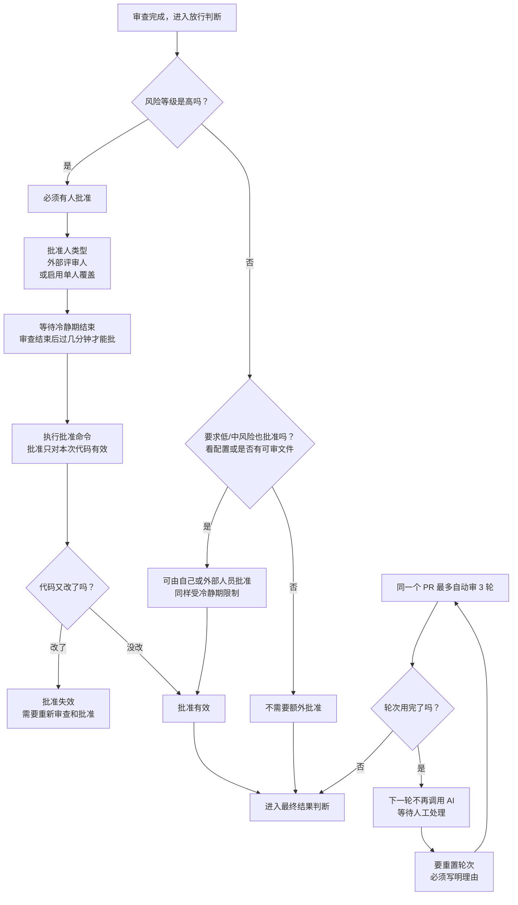
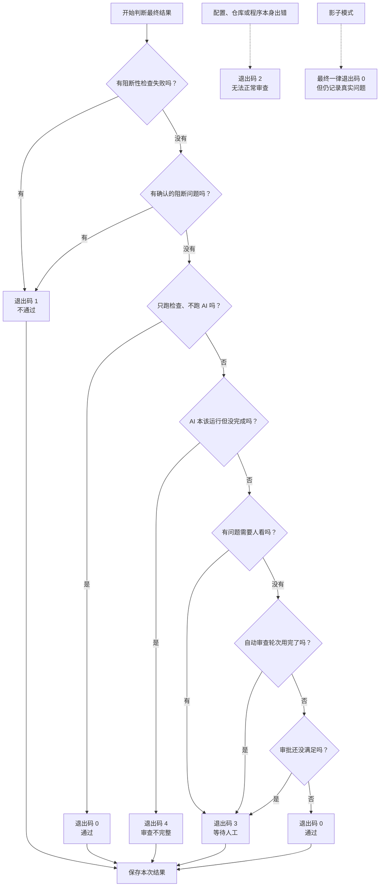

# review-tool 流程图（通俗版）

这份文档用尽量少的技术词，说明这个工具在一次审查里做了什么。图里的英文名词，最后都有“名词解释”。

先记住三句话：

1. 工具先用**不依赖 AI 的固定检查**筛一遍，再让 **AI 找问题**，最后**核对 + 投票 + 决定放行还是拦截**。
2. 普通审查只看“**这次改了什么**”；`full` 全量扫描是“**把整个项目分批看一遍**”。
3. 最后会给一个**退出码**：`0` 通过，`1` 不通过，`3` 等人批，`4` 没审完。

---

## 1. 一次普通审查的完整流程

**人话解释：**

你先告诉工具“拿当前代码和哪个分支比”。工具找出改动文件后，先跑不需要 AI 的检查，再用 AI 从不同角度找问题。AI 说的每个问题都会被核对：文件是否真实存在、行号对不对。之后由复核 AI 投票，决定问题是保留、丢弃，还是交给人判断。最后根据严重程度、审批和轮次，给出通过或拦截的结论。

---

## 2. 多个 AI 是怎么配合的

**人话解释：**

它们不是坐在一起聊天，而是“**各自独立做题，最后汇总投票**”。每个查找员只看一个角度，避免互相影响。工具把大家找到的问题合并、核对、去重；然后让复核员独立投票。确认票够就保留，否决票够就丢掉，票数不够就交给人。某个查找员失败不会拖垮全部，只有全部失败才算“审查不完整”。

---

## 3. 全量扫描（full）怎么跑

**人话解释：**

普通审查只看一次改动；全量扫描会把当前代码库按模块分成很多小批，逐批交给 AI 看。开始前先估算要花多少用量和费用，你可以设上限。中途可以停，下次从上次保存的进度继续。每批只找问题，没有多轮投票，所以结果只作参考，不会自动拦截。

---

## 4. 审批和轮次

**人话解释：**

高风险改动不能由工具自己说“通过”，必须有人批准；批准前还有一段冷静期。批准只对“这一次的代码”有效，代码一改就要重新审、重新批。同一个 PR 最多自动审 3 轮，避免无限花钱；轮次用完后要继续，必须写明理由。

---

## 5. 退出码：脚本怎么知道结果

**人话解释：**

退出码是一个数字，给自动化脚本判断这次审查能不能过。判断有先后顺序，先命中的规则生效。

| 退出码 | 通俗含义 |
|---|---|
| 0 | 审查完成，没有必须拦下的问题，审批也满足 |
| 1 | 有固定检查失败，或存在确认的阻断问题 |
| 2 | 工具本身出错：配置、仓库或程序异常 |
| 3 | 需要人处理：等人批准、有问题要人看、轮次用完 |
| 4 | 审查没做完：预算不够、AI 全部失败、AI 返回格式不对 |

---

## 6. 常见命令和流程的对应关系

| 你想做什么 | 命令 | 对应上面的哪张图 |
|---|---|---|
| 审查一次改动 | `review run --base main` | 第 1 张：普通审查 |
| 只跑固定检查 | `review checks --base main` | 第 1 张前半段 |
| 试算全量扫描要多少钱 | `review full --dry-run` | 第 3 张，到“只输出计划”为止 |
| 正式开始全量扫描 | `review full --yes` | 第 3 张完整流程 |
| 中途停止后继续 | `review full --resume --scan-id <编号>` | 第 3 张的“续跑” |
| 批准一次审查 | `review approve --run <编号>` | 第 4 张：审批 |
| 重置自动审查轮次 | `review reset-rounds --reason "<理由>"` | 第 4 张：轮次 |

---

## 7. 名词解释

| 名词 | 通俗解释 | 在这个工具里指什么 |
|---|---|---|
| 仓库 / repo | 存放代码的项目文件夹 | 你要审查的那个项目 |
| 分支 / branch | 代码的一条开发线 | 例如 `main` 是主线 |
| 提交 / commit | 一次代码存档 | 每次提交都有唯一编号 |
| HEAD | 当前最新的那次提交 | 普通审查默认审到 HEAD |
| diff / 差异 | 两次代码之间的不同 | 普通审查只 AI 看差异部分 |
| PR / 合并请求 | 请求把一条分支合进另一条 | 工具用 `--pr` 记录审查轮次 |
| 检查 / checks | 不需要 AI 的固定检查 | 格式、代码规范、编译、测试 |
| gitleaks | 查密钥泄露的工具 | 防止密码、令牌被提交 |
| Semgrep | 查代码安全问题的工具 | 按规则扫描常见漏洞 |
| osv | 查依赖漏洞的工具 | 检查第三方库有没有已知漏洞 |
| AI 查找员 / Finder | 负责找问题的 AI | 从不同角度提出候选问题 |
| AI 复核员 / Verifier | 负责给问题投票的 AI | 判断问题是否真实、是否值得保留 |
| 投票 | 多个独立意见汇总 | 标准/深度模式每个问题 3 票 |
| 核对 / grounding | 检查 AI 说的是不是真的 | 文件是否存在、行号是否有效 |
| 指纹 / fingerprint | 问题的唯一编号 | 用来识别重复问题，避免重复报告 |
| 严重度 | 问题有多严重 | 阻断 / 重要 / 轻微 |
| 预算 / budget | 最多允许花多少 | 分单次预算和每月预算 |
| token / 词元 | AI 的计费单位 | 可粗略理解为“字数”，输入输出都算钱 |
| 账本 / ledger | 只追加、不改写的流水账 | 每条记录和上一条串起来，便于查篡改 |
| 运行清单 / manifest | 一次审查的完整档案 | 记录配置、代码版本、检查、问题、结果 |
| 产物 / artifact | 审查生成的文件 | 报告、问题清单、检查日志 |
| 审批 / approval | 人工确认可以放行 | 高风险必须外部人员批准 |
| 冷静期 / cooldown | 审查后必须等一段时间才能批 | 防止刚出结果就随手点通过 |
| 单人覆盖 / solo override | 允许个人开发者给自己签字 | 会明确记录在账本里 |
| 轮次 / round | 同一个 PR 自动审了几次 | 默认最多 3 轮 |
| 影子模式 / shadow | 照常审、照常记，但不拦截 | 适合先观察效果再启用拦截 |
| 提示注入 / injection | 把恶意指令藏进文本里操纵 AI | 工具会检测可疑字符并记账 |
| bidi / 零宽字符 | 肉眼看不见的特殊字符 | 可能被用来隐藏代码或伪造显示 |
| 建议性质 / advisory | 结果只供参考 | 全量扫描默认不自动拦截 |
| 断点续扫 / resume | 从上次中断的地方继续 | 每批进度都会保存 |
| CLI / 命令行 | 在终端里输入命令使用工具 | 例如 `review run` |
| Mermaid | 用文字描述流程图的格式 | 本文件的图就是 Mermaid |
